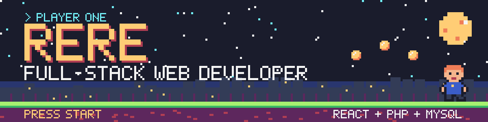
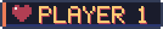
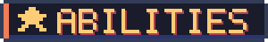
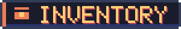
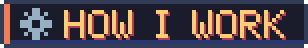
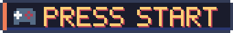
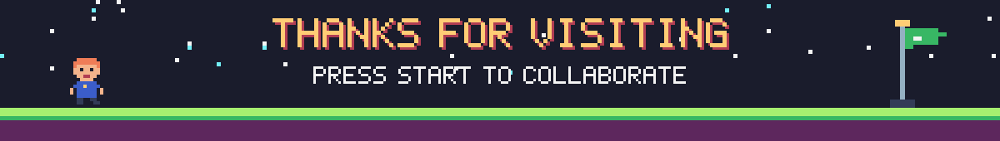

  

<!-- Add contact buttons here once you have them, e.g.

-->

 

I'm **Rere**, a full-stack web developer who turns ideas into **complete, working products**. I build responsive interfaces in **React**, power them with **PHP** back ends and model the data in **MySQL**. Give me a feature and I'll own it end to end, from the first sketch to the deploy.

 

<table>
<tr>
<td width="33%" valign="top">

**🎨 Frontend**

Responsive, accessible interfaces in React and modern JavaScript, with reusable components and layouts that hold up on every screen.

</td>
<td width="33%" valign="top">

**⚙️ Backend**

Reliable PHP services and APIs: forms, authentication and the business logic that keeps an app running smoothly.

</td>
<td width="33%" valign="top">

**🗄️ Data**

Well-structured MySQL schemas and efficient queries, so apps stay fast as the data grows.

</td>
</tr>
</table>

 

  

 

- **Ship, then polish.** Get a working version in front of people early, then refine with real feedback.
- **Readable over clever.** Code the next developer can pick up without a guided tour.
- **Users first.** Fast loads, clear flows and interfaces that don't need instructions.
- **Always leveling up.** Every project teaches me something new. Right now, it's Python.

 

 

I'm open to **freelance projects, full-time roles and collaborations**. If you need someone who can take a web app from idea to launch, let's talk.

Bonus level: humans share about 60% of their DNA with bananas. 🍌

 

